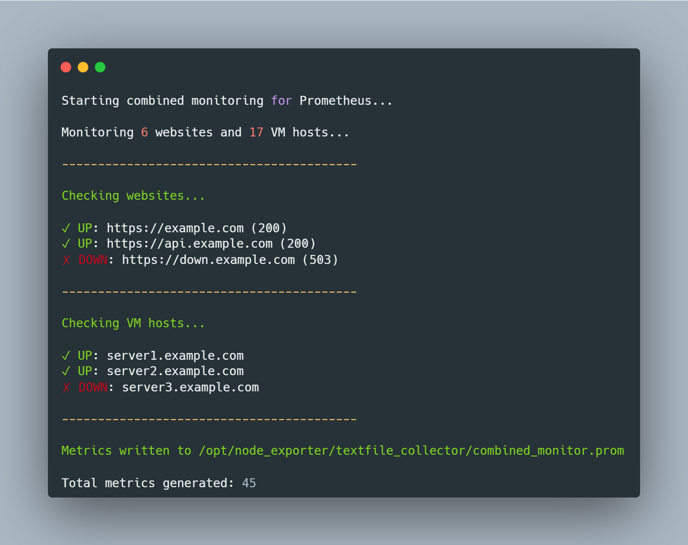

# Blackbox Lite


A comprehensive Bash script that monitors websites and VM hosts, collecting metrics in Prometheus format for integration with Node Exporter's textfile collector. It can also run as a **standalone CLI health checker** without any Prometheus setup. This tool provides real-time monitoring of website availability, SSL certificate health, response times, and VM host connectivity.

## Features

### Website Monitoring

- **Availability Check**: Monitors website uptime with HTTP status code validation
- **Response Time**: Measures website response time in seconds
- **SSL Certificate Monitoring**:
	- Validates SSL certificate validity
	- Tracks days until certificate expiration
	- Detects TLS version in use
- **HTTP Status Codes**: Captures and reports HTTP response codes
- **Follow Redirects**: Automatically follows HTTP redirects (3xx)

### VM Host Monitoring

- **Ping Connectivity**: Tests host reachability using ICMP ping
- **Response Time**: Measures average ping response time

### Additional Features
- **YAML Configuration**: External config file support - no script edits needed to add/remove targets
- **Parallel Execution**: All checks run concurrently with configurable job limits
- **CLI-Only Mode**: Use `--cli` for quick health checks without Prometheus - no textfile collector required
- **Prometheus-Compatible**: Outputs metrics in standard Prometheus textfile format
- **Atomic Writes**: Uses temporary files for safe metric updates
- **Error Handling**: Strict mode (`set -Eeuo pipefail`), error traps, and dependency checking
- **Metadata Metrics**: Includes monitoring run timestamps and target counts

### Required Dependencies

The script automatically checks for and requires the following tools:

- **curl**: For HTTP/HTTPS website checks
- **openssl**: For SSL certificate validation and TLS version detection
- **ping**: For VM host connectivity testing
- **bc**: For mathematical calculations (response time conversions)


## Configuration

### Option 1: YAML Config File (Recommended)

Create a `config.yaml` alongside the script:

```yaml
# Path where Prometheus metrics are written
textfile_path: "/opt/node_exporter/textfile_collector/combined_monitor.prom"

# Websites to monitor
websites:
  - "https://example.com"
  - "https://api.example.com/health"
  - "http://internal.example.com:8080"

# VM hosts to monitor
vm_hosts:
  - "server1.example.com"
  - "192.168.1.100"

# Parallel execution settings
parallel:
  max_jobs: 5
```

Then run with:
```bash
./monitor.sh --config config.yaml
```

### Option 2: Hardcoded Defaults (Fallback)

If no `--config` flag is provided, the script uses the built-in arrays as a fallback. Edit the `DEFAULT_WEBSITES` and `DEFAULT_VM_HOSTS` arrays directly in the script:

```bash
DEFAULT_WEBSITES=(
    "https://example.com"
    "https://api.example.com"
)

DEFAULT_VM_HOSTS=(
    "server1.example.com"
    "192.168.1.100"
)
```

## Usage

### CLI Reference

```
monitor.sh v2.0.0 - Prometheus website & VM host monitor

Usage:
  monitor.sh [options]

Options:
  -c, --config <file>   Path to YAML config file
      --cli             CLI-only mode (skip Prometheus file output)
  -h, --help            Show this help

Examples:
  ./monitor.sh                              # Use hardcoded defaults
  ./monitor.sh --config config.yaml         # Load targets from config
  ./monitor.sh --cli                        # Quick CLI health check
  ./monitor.sh --config config.yaml --cli   # Config + CLI-only
```

### Manual Execution
```bash
./monitor.sh                              # Hardcoded defaults → Prometheus output
./monitor.sh --config config.yaml         # YAML config → Prometheus output
./monitor.sh --cli                        # Hardcoded defaults → CLI only
./monitor.sh --config config.yaml --cli   # YAML config → CLI only
```

### Scheduled Execution with Cron
Add to crontab for automated monitoring (runs every 5 minutes):
```bash
crontab -e
```

Add the following line:
```bash
*/5 * * * * /path/to/monitor.sh --config /path/to/config.yaml >/dev/null 2>&1
```

Or for more frequent monitoring (every minute):
```bash
* * * * * /path/to/monitor.sh --config /path/to/config.yaml >/dev/null 2>&1
```

## CLI-Only Mode

Use `--cli` to run the script as a **standalone health checker** without any Prometheus setup:

```bash
./monitor.sh --cli
./monitor.sh --config config.yaml --cli
```

In this mode the script:
- Runs all website and VM host checks in parallel
- Displays UP/DOWN results on the terminal
- **Skips** writing the `.prom` metrics file
- **Skips** the textfile collector directory check

This makes it usable by anyone - no Prometheus or Node Exporter required.

## Parallel Execution

All website and VM host checks run **in parallel by default**. The number of concurrent jobs is controlled by:

| Source           | Setting                | Default |
|------------------|------------------------|---------|
| Config file      | `parallel.max_jobs`    | `5`     |
| Script default   | `MAX_PARALLEL_JOBS`    | `5`     |

Each check runs in a background subshell with isolated output files. Console results are replayed in order after all jobs complete, so the output remains deterministic.

## Integration with Prometheus

### Node Exporter Configuration

1. **Install Node Exporter** (if not already installed)
2. **Configure Node Exporter** to use the textfile collector:
   Edit `/etc/systemd/system/node_exporter.service` or your Node Exporter configuration:

```ini
   [Service]
   ExecStart=/usr/local/bin/node_exporter \
       --collector.textfile.directory=/opt/node_exporter/textfile_collector \
       --collector.textfile
```

3. **Verify metrics are being collected**:

```bash
   curl http://localhost:9100/metrics | grep website_
   curl http://localhost:9100/metrics | grep vm_host_
```
  
## Examples Output
  

## Contributing

Contributions are welcome! Please feel free to submit a Pull Request. For major changes, please open an issue first to discuss what you would like to change.


